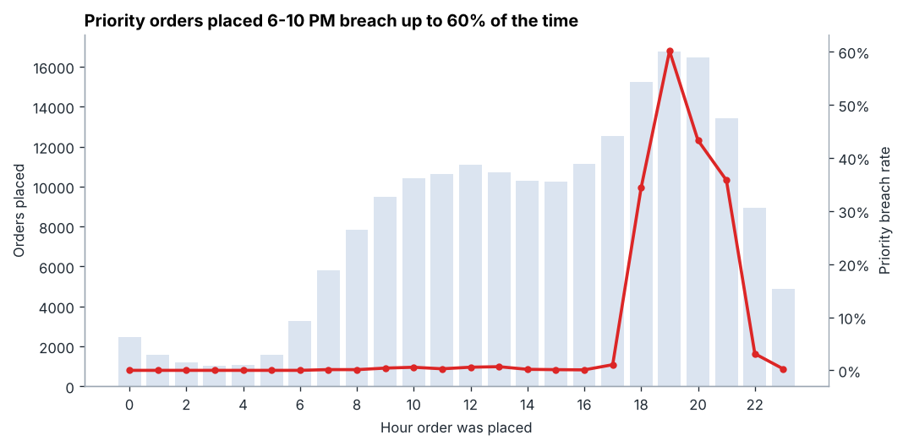
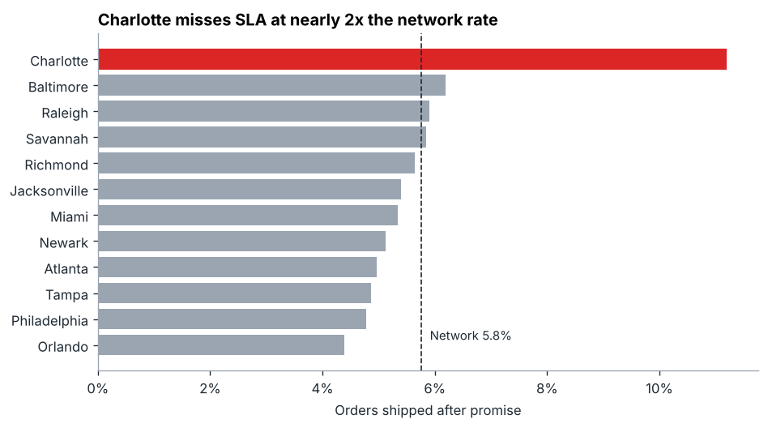
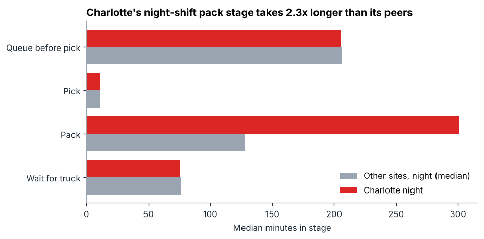
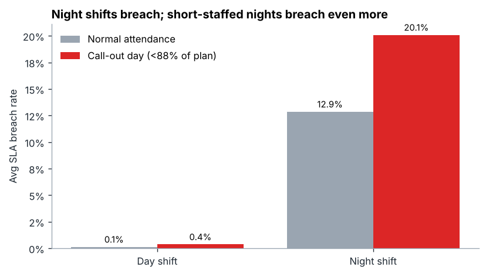
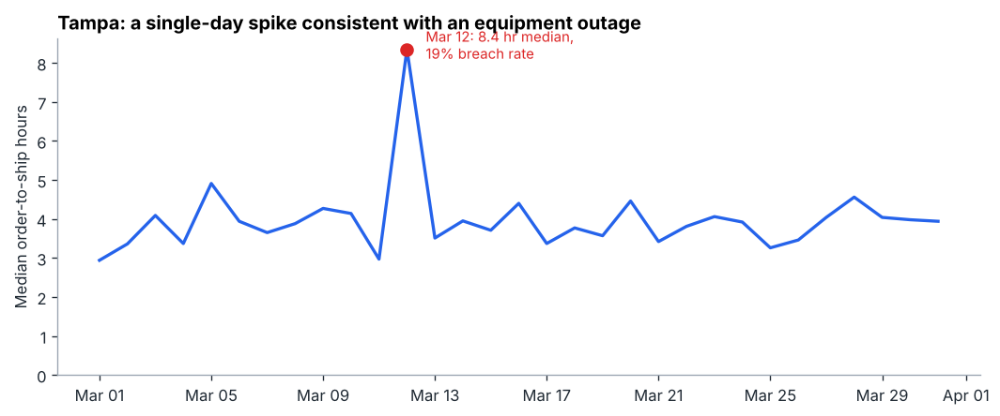

# flowmetrics

**Where does a fulfillment network lose its delivery promise?**

A SQL and Python analysis of one month of order scan events across a 12-site East Coast fulfillment
network. The analysis finds where, when, and why orders ship late, and recommends what to fix first.

**Tools:** SQL (DuckDB) · Python (pandas, matplotlib) · Jupyter · Tableau-ready extracts

---

## Executive summary

The network ships **5.8% of orders after their promised ship time**. Standard orders (24-hour promise)
almost never miss. **Priority orders (8-hour promise) miss 14% of the time**, and they account for 93%
of all breaches.

| # | Finding | Evidence |
|---|---------|----------|
| 1 | **The evening surge drives almost every breach.** | Orders placed 5–10 PM are 38% of volume but **98% of SLA breaches**. Priority orders placed 6–10 PM breach 34–60% of the time; outside that window, 3% or less. |
| 2 | **Night shifts are planned too lean for the surge they absorb.** | Night shifts move 43% of units with 60% of the day shift's headcount, so each associate handles **~25% more volume**. Night orders wait about **4x longer** in the pick queue. |
| 3 | **Charlotte has a local pack-line problem on top of that.** | Charlotte breaches at **1.9x the network rate**. Its night-shift pack stage takes a median of 301 minutes vs. 128 at peer sites (**2.3x slower**), while its pick and queue times are normal. |
| 4 | **Call-outs make bad nights worse.** | When night attendance falls below 88% of plan, the breach rate rises from **12.9% to 20.1%**. Day shifts stay under 0.5% either way. |
| 5 | **One-off incidents are detectable within a day.** | An anomaly check flagged **Tampa on March 12**: median cycle time jumped from ~3.8 to 8.4 hours and 19% of orders breached, driven by the pack-to-truck wait, consistent with a sortation outage. It also flagged **Jacksonville on March 7**, a night shift that ran at 72% of planned headcount. |

### Recommendations

1. **Re-plan night labor around the evening surge.** Add a swing shift (for example 4 PM–2 AM) that covers
   the window producing 98% of breaches, instead of adding headcount evenly across the night.
2. **Fix Charlotte's night pack line first.** It's the single largest site-specific gap.
3. **Add a call-out buffer for nights:** a flex pool or overtime trigger when attendance drops below 88% of plan.
4. **Run the anomaly query daily** so incidents like Tampa's are escalated the same day.





| | |
|---|---|
|  |  |



---

## Business questions

Each question is answered by one SQL file in [`sql/`](sql/).

| Query | Question |
|---|---|
| `00_data_quality.sql` | How clean is the raw feed, and what gets removed? |
| `01_network_kpis.sql` | How is the network performing overall, by service tier? |
| `02_sla_by_site.sql` | Which sites breach SLA most, relative to the network? |
| `03_sla_by_hour.sql` | When during the day do breaches happen? |
| `04_stage_bottlenecks.sql` | Which process stage (queue, pick, pack, dock) is the bottleneck, and where? |
| `05_staffing_vs_breach.sql` | Does labor (shift plan, attendance) explain the breaches? |
| `06_daily_trend.sql` | Were there one-off incidents? (z-score anomaly detection per site) |

The full walkthrough, with every query result and chart, is in
[`notebooks/flowmetrics_analysis.ipynb`](notebooks/flowmetrics_analysis.ipynb).

## Data

The data is **synthetic**, generated by [`src/generate_data.py`](src/generate_data.py) (seeded, so it's
fully reproducible). It's modeled on how real fulfillment operations behave: hourly order rhythms with
an evening peak, pick → pack → ship stages, carrier trucks departing every two hours, labor capacity
from a shift staffing plan, and congestion that grows when hourly volume exceeds capacity.

| File | Grain | Rows |
|---|---|---|
| `data/raw/order_events.csv.gz` | One row per order scan record (1-in-10 sample of network volume) | ~200K |
| `data/raw/staffing.csv` | Site × day × shift, planned and actual headcount | 744 |
| `data/raw/sites.csv` | Site reference | 12 |

The raw feed includes realistic defects the analysis has to clean: duplicate scans (0.4%), missing pack
scans (0.3%), and clock-skew records (0.1%). In total, 1,589 rows (0.8%) are removed in
[`sql/clean_orders.sql`](sql/clean_orders.sql) before any KPI is calculated.

**SLA definition:** an order breaches when it ships after `order time + SLA hours` (8 hours for Priority,
24 for Standard).

## Tableau

`data/processed/tableau_extract.csv` (site × date × hour × tier, ~17K rows) is built for Tableau. Every
chart above can be rebuilt from it with `SUM(breaches) / SUM(orders)` as the breach-rate measure, and
filters on site, date, shift, and tier. The other files in `data/processed/` are the result of each SQL
query.

## Run it yourself

```bash
pip install -r requirements.txt
python src/generate_data.py      # build the raw dataset
python src/run_analysis.py       # run all SQL, write results to data/processed/
jupyter notebook notebooks/flowmetrics_analysis.ipynb
```

## Project structure

```
flowmetrics/
├── data/
│   ├── raw/            # generated source data
│   └── processed/      # query results + Tableau extract
├── notebooks/          # analysis walkthrough with charts
├── reports/figures/    # charts used in this README
├── sql/                # cleaning layer + one file per business question
└── src/                # data generator, SQL runner, notebook builder
```
